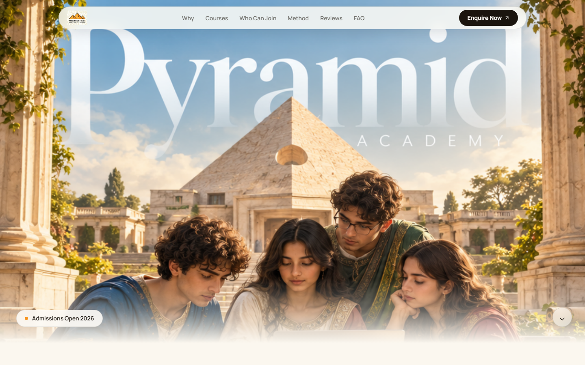
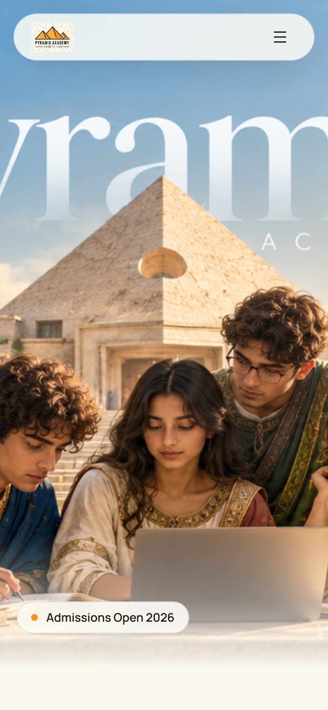
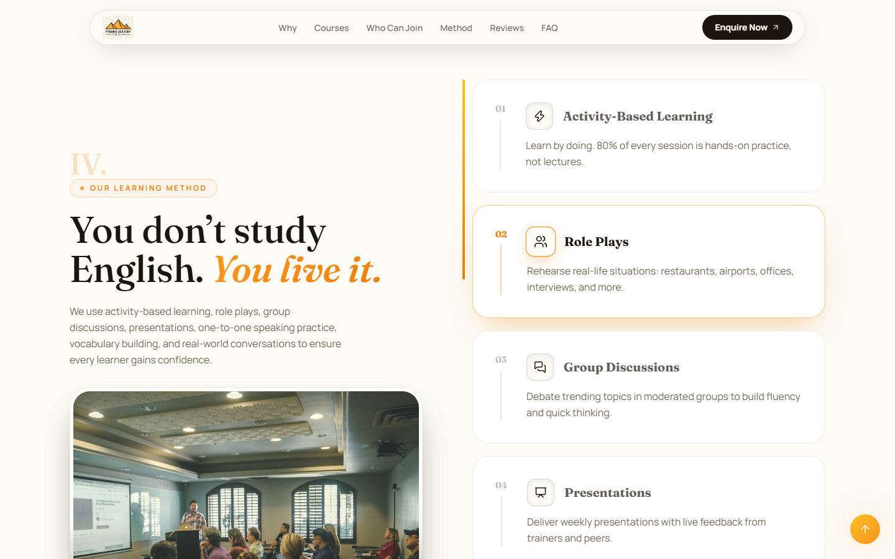

# PYRAMID ACADEMY · Website Redesign Demo

**A classical-luxury redesign concept for the Pyramid Academy spoken English institute, built as a single-page animated experience.**

Light cream canvas, oil-painting art direction, engraved iconography, and motion choreographed end to end: a preloader, a full-bleed classical hero, scroll-driven reveals, count-ups, an accordion course catalog, a live batch countdown, and an enquiry flow. All content is inflated demo data by design.



| Desktop | Mobile |
|---|---|
|  |  |
|  |  |

---

## Highlights

- **Full-bleed classical hero.** An AI-generated oil painting (wordmark baked into the sky) with a slow ken-burns entrance, gentle infinite drift, and a floating ivory navbar that melts into the scene.
- **Framed-miniature icon tiles.** Every thematic icon lives in an ivory, ink-keylined frame like a gallery print; the active Learning Method step highlights with an orange ring.
- **Scroll choreography.** Lenis smooth scroll plus Framer Motion `whileInView` reveals, a learning-method timeline whose steps light up as they cross the viewport center, and a progress line that fills with scroll.
- **Animated numbers.** Spring-driven count-ups for the inflated stats (50,000+ learners, 4.9/5, 98%), a live countdown to the next demo batch, and a 98% radial progress ring.
- **Interactive catalog.** Seven courses in an expanding accordion with photos, tags, and meta; animated FAQ accordion; auto-advancing testimonial carousel.
- **Swap-ready asset pipeline.** Drop AI-generated art into two folders and the site upgrades itself with zero code changes (see below).

## Design System

**Palette** (derived from the client logo)

| Token | Value | Use |
|---|---|---|
| `cream` | `#FBF7EF` | Page background |
| `ivory` | `#FDFBF6` | Cards, navbar pill, tiles |
| `sand` | `#F3EADA` | Alternate section rhythm |
| `ink` | `#1B150E` | Headings, keylines |
| `orange-500` | `#F7931E` | Primary accent, CTA gradient |
| `amber-400` | `#FBBF24` | Gradient partner, stars, marquee |

**Typography**

- **Fraunces** (9..144 optical sizes, upright + italic) for display headlines, chapter numerals I. to VII., and stat numerals.
- **Manrope** for UI text, labels, and body copy.

**Motifs**

Chapter numerals and gold hairline rules over each section, pyramid-glyph watermarks, gallery frames (6px ivory matting + ink keyline + warm shadow), and warm "painted" photo grading (`sepia + saturate`) so every image sits inside the same classical world as the hero painting.

## Tech Stack

| Layer | Choice |
|---|---|
| Build | Vite 8 |
| UI | React 19 (JavaScript) |
| Styling | Tailwind CSS v4 via `@tailwindcss/vite` |
| Animation | Framer Motion 13 (reveals, springs, layout, AnimatePresence) |
| Smooth scroll | Lenis |
| Icons | Hand-built inline SVG set (`src/components/icons.jsx`), no icon library |
| Lint | oxlint |

## Quick Start

```bash
npm install
npm run dev        # local dev server with hot reload
npm run build      # production build to dist/
npm run preview    # serve the production build
npm run lint       # oxlint
```

## Project Structure

```
├── index.html                  # fonts (Fraunces + Manrope), meta, favicon
├── public/
│   ├── logo.png                # brand logo (multiply-blended on cream)
│   ├── hero-art.png            # AI-generated classical hero painting
│   ├── images/                 # warm-filtered fallback photo set (Unsplash)
│   ├── art/                    # (optional) AI section artworks, see below
│   └── icons-gen/              # (optional) engraved icon PNGs, see below
├── docs/screenshots/           # README imagery
└── src/
    ├── main.jsx                # React entry
    ├── App.jsx                 # Lenis init, preloader gate, section composition
    ├── index.css               # Tailwind v4 @theme tokens + custom utilities
    ├── data.js                 # ALL content: courses, stats, FAQs, demo numbers
    └── components/
        ├── Preloader.jsx       # progress counter + exit wipe (failsafe-guarded)
        ├── Navbar.jsx          # floating pill nav, mobile menu
        ├── Hero.jsx            # full-bleed painting + serif headline zone
        ├── Stats.jsx           # animated count-ups
        ├── WhyPyramid.jsx      # bento gallery + progress ring
        ├── Courses.jsx         # expanding accordion
        ├── WhoCanJoin.jsx      # photo-header audience cards
        ├── LearningMethod.jsx  # sticky column + scroll-highlighted steps
        ├── Testimonials.jsx    # auto-advancing carousel
        ├── Faq.jsx             # animated accordion
        ├── AdmissionsCTA.jsx   # countdown + enquiry form + success state
        ├── Footer.jsx          # ink footer with logo tile
        ├── BackToTop.jsx
        ├── Reveal.jsx          # shared whileInView wrapper + SectionHeading
        ├── ArtImg.jsx          # art-swap image slot (onError fallback)
        ├── IconArt.jsx         # art-swap icon slot (multiply-blended)
        ├── PyramidWatermark.jsx# decorative pyramid glyph
        └── icons.jsx           # inline SVG glyph dictionary
```

## Content and Data

Every string, stat, testimonial, batch date, and contact detail lives in **`src/data.js`** and is intentionally inflated demo data (50,000+ learners, 12,400+ reviews, 4.9/5). Replace it with real institute content there and the whole site updates. No backend: the enquiry form simulates submission with a success state.

## AI Art Pipeline

The site is built to absorb client-generated classical artwork without code changes.

**1. Section paintings.** Drop JPGs into `public/art/` using these names. `ArtImg` shows your painting when present and falls back to the warm-filtered photo otherwise:

| File | Section | Scene to generate |
|---|---|---|
| `why.jpg` | Why Pyramid bento | Mentor guiding learners in a columned courtyard |
| `method.jpg` | Learning Method | Orator demonstrating a gesture to repeating learners |
| `cta.jpg` | Admissions panel | Dignified celebration, scrolls raised toward a pyramid |
| `courses.jpg` | Courses intro | Study still life: books, inkwell, globe, pyramid through an arch |
| `speaking.jpg` | Spoken English | Two figures in animated conversation |
| `interview.jpg` | Interview Skills | Candidate before robed examiners |
| `public-speaking.jpg` | Public Speaking | Orator on marble steps, crowd gathered |
| `communication.jpg` | Communication | Circle of youths in debate |
| `personality.jpg` | Personality Development | Confident speaker mid-gesture |
| `beginner.jpg` | Beginner English | Guided writing by candlelight |
| `corporate.jpg` | Corporate Communication | Council table with scrolls and maps |
| `audience-*.jpg` (5) | Who Can Join cards | students, professionals, jobseekers, homemakers, entrepreneurs |

**Style suffix for all paintings (keeps them in the hero's world):**

> classical oil painting, Renaissance style, warm golden-hour light, sandstone pyramid architecture and columns, amber cream and teal palette, painterly brushstrokes, chiaroscuro, museum quality, no text, no watermark

**2. Engraved icons.** Drop square PNGs (sepia ink on plain cream background) into `public/icons-gen/`. The site multiply-blends the cream away, so the engraving prints onto its ivory tile. Names: `mic`, `book-open`, `messages-square`, `sparkles`, `handshake`, `presentation`, `columns`, `torch`, `open-gate`, `clasped-hands`, `compass`, `graduation-cap`, `ledger`, `target-arrow`, `hearth-home`, `merchant-scale`, `raised-hand`, `theatre-masks`, `forum-circle`, `scroll-podium`, `whisper-voice`, `inkwell-quill`, `antique-globe`, `ornamental-quote`, `wax-seal`, `pocket-watch`, `calendar-scroll`, `candlestick-phone`, `sealed-envelope`, `obelisk-pin`, `laurel-check`, `paper-quill`.

**Icon style suffix:**

> antique copperplate engraving, fine crosshatched sepia-brown ink linework on plain cream paper, 1800s scientific book illustration, single centered subject, square, no text, no border, no watermark

## Deployment

`npm run build` emits a static `dist/` (single JS/CSS bundle plus assets). Host it on any static provider (GitHub Pages, Netlify, Vercel, S3). No server logic required. Consider compressing `hero-art.png` (2 MB) before a production deploy.

## Notes

- This is a design and motion demo, not affiliated production content for SPECTRUM Education.
- All imagery is either client-generated (logo, hero painting) or sourced from Unsplash as placeholder photography.
